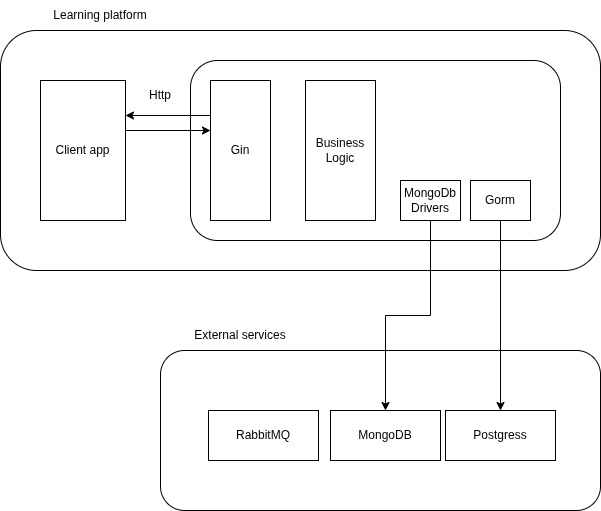
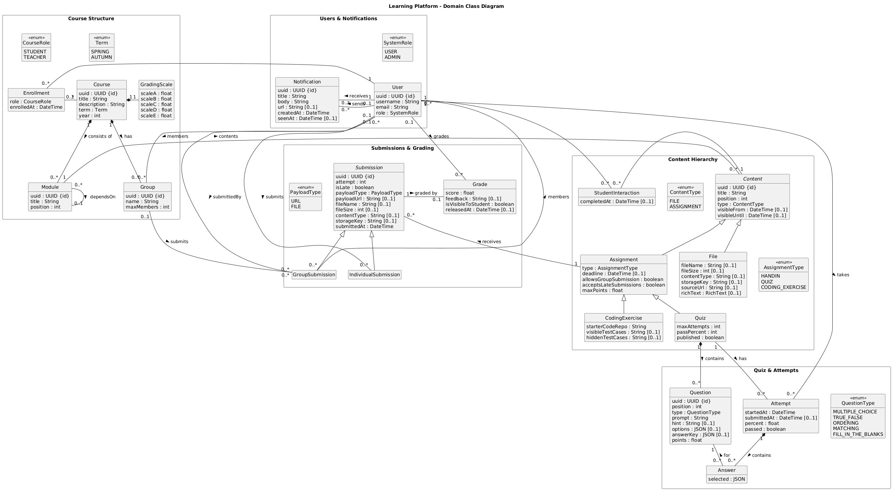

# Architecture & Technology Stack

<!--toc:start-->
- [Architecture & Technology Stack](#architecture--technology-stack)
  - [System Architecture](#system-architecture)
    - [Client and Backend Communication](#client-and-backend-communication)
    - [Backend Structure](#backend-structure)
    - [External Services](#external-services)
  - [Domain Model](#domain-model)
  - [Technology Stack](#technology-stack)
  - [New Technologies](#new-technologies)
    - [Go (Gin, GORM, Uber Dig)](#go-gin-gorm-uber-dig)
    - [Vue 3 and Vuetify](#vue-3-and-vuetify)
    - [SeaweedFS](#seaweedfs)
    - [MongoDB](#mongodb)
<!--toc:end-->

## System Architecture

### Client and Backend Communication

- the frontend is a Single-Page Application (SPA) built with Vue 3 and Vuetify (`client/`)
- it communicates with the Go backend (`server/`) over HTTP through a REST API (`/api`) and Server-Sent Events (`/api/notification/stream`) for live notifications
- in development (`task dev`), Vite runs on port `3000` and proxies `/api` requests to the Go server on port `8080`
- in production (`Dockerfile`), the Vue app is compiled into static files (`server/web/dist`) and embedded directly into the Go binary so the entire platform runs as a single container

### Backend Structure

#### Gin HTTP Layer (`api.go`)

- handles routing, request parsing, JWT and role checks (`util/authutils`), and Swagger annotations

#### Business Logic Layer (`db.go`)

- implements service interfaces for each domain package and coordinates calls to the database, file storage, SSE notification hub, and message queue

#### Background Workers (`app/worker.go`, `submission/consumer.go`, `submission/reminder.go`)

- run inside the backend process alongside the HTTP server:
  - `SubmissionConsumer` (`Worker` in diagram) listens to RabbitMQ for queued assignment submissions and writes individual and group submission records to PostgreSQL via GORM
  - `DeadlineReminderWorker` (`Reminder Worker` in diagram) periodically queries PostgreSQL every minute for active assignments due within 24 hours or 15 minutes and dispatches reminders through the notification service and SSE Hub to enrolled students who have not yet submitted

#### Dependency Injection (`app/dig.go`)

- uses Uber Dig to wire up database connections, storage services, API controllers, and background workers at startup

### External Services

#### PostgreSQL

- main relational database accessed through GORM for storing users, courses, enrollments, groups, modules, course content, quizzes and attempts, student interactions, submissions, upload tickets, deadline reminders, grades, and notifications

#### MongoDB

- document store used by the auth service to store active user refresh token sessions

#### SeaweedFS

- object storage service accessed over its HTTP Filer API (`:8888`) to store uploaded course material files and student assignment submission blobs

#### RabbitMQ

- message broker used for asynchronous assignment submissions:
  - when a student or group submits an assignment (either a URL or a file uploaded to SeaweedFS using a two-phase `UploadTicket`), the backend stamps the receipt timestamp and publishes a message to RabbitMQ (`202 Accepted`)
  - the background worker consumes the message from RabbitMQ and persists the submission record in PostgreSQL (snapshotting group members for group submissions), retrying once on transient errors before routing failed messages to a dead-letter queue (DLQ)

## Domain Model

To avoid circular dependencies in Go while keeping GORM relationships easy to preload, the domain models are grouped into cohesive packages under `server/` forming a directed acyclic dependency graph (`grade` -> `submission` / `quiz` -> `content` -> `course` -> `user`):

#### `user` & `auth`

- global user accounts (`admin`, `user`) and authentication

#### `course`

- `Course` (with an embedded `GradingScale` for letter grades A–F), `Enrollment` (per-course role `STUDENT` or `TEACHER`), `Group` (with `MaxMembers` and member associations), and `Module` (ordered modules with optional `DependsOn` prerequisites)

#### `content`

- two-level Class Table Inheritance hierarchy where base `Content` (`ContentID`) is extended by `File` (course pages/materials) and `Assignment` (`HANDIN`, `QUIZ`, `CODING_EXERCISE` with `Deadline`, `MaxPoints`, `AllowsGroupSubmission`, and `AcceptsLateSubmissions`), and `Assignment` is further extended by `Quiz` (with `Question`) and `CodingExercise`, plus `StudentInteraction`

#### `quiz`

- student quiz `Attempt` and per-question `Answer` records, along with automated scoring and quiz announcement logic

#### `submission`

- base `Submission` embedded by `IndividualSubmission` and `GroupSubmission` (with snapshotted `group_submission_members`), plus `UploadTicket` (two-phase file upload reservation) and `DeadlineReminder`

#### `grade`

- `Grade` model (referencing either an `IndividualSubmission` or a `GroupSubmission`), cumulative course grade calculation, and CSV gradebook export

#### `notification`

- `Notification` model and in-memory SSE `Hub`

## Technology Stack

| Area | Technology |
| --- | --- |
| Backend language | Go 1.25 |
| HTTP framework & DI | Gin, Uber Dig, Zap (logging) |
| Relational DB & ORM | PostgreSQL 17, GORM (and in-memory SQLite for tests) |
| NoSQL & Object Storage | MongoDB (refresh sessions), SeaweedFS (file blobs) |
| Messaging & Real-Time | RabbitMQ (`amqp091-go`), Server-Sent Events (SSE) |
| Frontend | Vue 3, TypeScript, Vuetify 3, Vue Router, Axios, `@vue-office` |
| Security | JWT (HS256 access tokens), HTTP-only refresh cookies, bcrypt |
| DevOps & Tooling | Docker Compose, Taskfile, Air (hot reload), Swaggo (Swagger), GitLab CI |

## New Technologies

Instead of the default lecture stack (Java, Spring Boot, Hibernate/H2, React), we used several technologies that were not part of the standard list:

### Go (Gin, GORM, Uber Dig)

#### Where and why

- used for the entire backend (`server/`)
- we chose Go for fast build times, simple concurrency with goroutines and channels (which made the RabbitMQ background worker and SSE notification hub straightforward to build), and low memory usage in Docker

#### How well it worked

- worked very well for API performance and testing
- running unit tests with an in-memory SQLite database via GORM was fast and allowed us to keep test coverage above 90%
- the main challenge with Go and GORM was avoiding circular imports between domain models, which we solved by grouping related models into cohesive domain packages (`course`, `content`, `quiz`, `submission`, `grade`)

### Vue 3 and Vuetify

#### Where and why

- used for the web client (`client/`)
- we chose Vue 3 with `<script setup>` and TypeScript because it has less boilerplate than React, and Vuetify gave us ready-made Material Design components and a shared theme configuration (`plugins/vuetify.ts`)

#### How well it worked

- Vuetify sped up building views like the course catalog, module lists, and dialogs while keeping styling consistent across the team
- we also paired it with `@vue-office/docx` and `@vue-office/pptx` to render Word documents and PowerPoint slides directly in the browser

### SeaweedFS

#### Where and why

- used as our NoSQL object storage (`server/util/storage/`) for course materials (`File`) and student assignment hand-ins
- we picked SeaweedFS because its Filer REST API lets us upload, stream, and delete files using standard Go `net/http` requests without needing a heavy S3 SDK

#### How well it worked

- very lightweight to run in Docker Compose and easy to mock in unit tests using an in-memory `MemoryStorageService` implementation of our `IStorageService` interface
- one thing we had to handle manually was deleting files from SeaweedFS when a module or course was deleted in PostgreSQL, since database cascade deletes do not clean up external object storage

### MongoDB

#### Where and why

- used in `server/auth/` to store refresh token sessions
- storing sessions in MongoDB kept authentication state separate from our relational LMS tables in PostgreSQL

#### How well it worked

- simple to integrate for looking up, validating, and revoking user sessions on login, refresh, and logout

