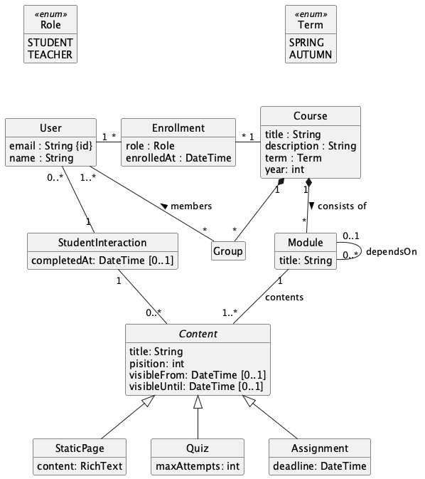

# DAT250 Course Project: An Ideal Learning Management System

## Background and Method

The best way to learn something is by doing! DAT250 is therefore centred around
building _something_: throughout the semester, you will develop a larger,
"enterprise-ready" software product using a range of technologies.

The project is intended for groups of 3–4 students. Smaller or larger groups
may be acceptable after agreement with the course teachers.

This course is not about methodology (this in fact the topic of DAT251).
Hence, you are completely _free_ to choose your project methodology (agile, waterfall, ...)
how you want to organize yourself, and what your technology stack is.
Likewise, the use of generative AI is up to you:
whether you use it, which tools you use, and to what degree (see [Use of
Artificial Intelligence](#use-of-artificial-intelligence)).

The main goal of the project is that you know _what_ you are doing and _why_
you are doing it. You will therefore deliver a software product together with
documentation of your process. It is not essential that every feature is fully
developed or that the code is perfectly clean. What matters most is that you
can explain what you did, why you did it that way, and what you would change if
you did it again.

The project and its documentation form the basis for an "expert discussion" at
the oral exam, which determines your grade in this course.

## Product Vision

Your task is to build the _ideal_ **Learning Management System (LMS)**. Think
of Canvas, and then imagine how you would like it to be: both as a student
following a course and as a teacher creating one.

> For students and teachers who spend a large part of their week inside an LMS,
> our system is a place where course content is easy to create, easy to find,
> and engaging to work with. Unlike many of today's platforms, which can feel
> like a file archive with a calendar attached, it supports active learning
> through interactive quizzes, automatically graded coding exercises, and fast,
> meaningful feedback.

The system allows teachers to create courses and students to attend them. A
course is organised into modules, which may contain web pages, multimedia
content, interactive quizzes, coding exercises, and hand-in assignments.

The sections below specify the _core requirements_ in the form of a domain
model, a set of user stories, and a list of technical requirements. How you
realise them, and which additional features you add, is up to you.

## Domain Description

### Users and Roles

The system distinguishes between two roles: _students_ and _teachers_. Roles
are assigned **per course**, so the same user can be a student in course A and
a teacher in course B. Users are identified by their e-mail address.

### Courses and Modules

A course is the central entity of the system. Every course has a title, a
description, and a semester (e.g. _Autumn 2026_).

Course content is organised into ordered **modules** (e.g. "Week 1:
Introduction"), each of which contains an ordered list of content items. A
course that does not need any structure simply consists of a single module. The
following kinds of content items exist:

- **Pages** are static web pages where teachers publish course material for
students to read. Pages may embed multimedia content such as images and videos.
- **Quizzes** let students test their knowledge. A quiz consists of questions
of different types, e.g. multiple choice, ordering, matching, and
fill-in-the-blanks. A quiz may allow one or several attempts and may show hints
when an answer is wrong.
- **Coding exercises** provide starter code (e.g. a Git repository that
students can clone directly) and optionally a set of visible and hidden test
cases that are used to grade submissions automatically.
- **Assignments** can both be traditional hand-in exercises where students upload a
document, e.g. a PDF or Word file, or a _coding exercise_ when this is a course incvoling programming 
(e.g. a git repository is provided that the students can clone directly, together with (optionally)
a set of visible or hidden test cases that can be used to grade the submission automatically).

### Visibility, Deadlines, Groups, and Grading

- The visibility of any content item can be restricted to a time window, e.g. a
page becomes visible on Monday at 08:00.
- Quizzes, coding exercises, and assignments may have a deadline. For
exercises, teachers decide whether late submissions are accepted; late
submissions are flagged as such.
- Coding exercises and assignments may be solved in **groups**. A group hands
in a single submission on behalf of all its members, and the resulting grade
applies to every member.
- Quiz attempts and coding submissions can be graded automatically, while
assignments are graded manually. Teachers can add written feedback to any grade
and decide when grades become visible to students.

### Domain Model

The UML class diagram below depicts a base domain model, which contains the main entities:
_courses_, _users_, _enrollments_, _modules_ etc. Please note that the `position` of a _Content_ 
item refers to its position within the module. Also, there are optional dependencies between modules
with the intended semantics that a dependent module may only be visible once all required modules are completed,
i.e. all their contents have been "interacted with", see `StudentInteraction` (may require refinement w.r.t. 
quizzes and assinments below).

Most likely, you will need to refine this model in order to express different types of quizzes
and assignments, account for different submission channels (do not forget to define the semantics 
of group submissions), as well as detailing the "static page" content type.
Also, feel free to make further changes to the model if required.

## User Stories

The user stories below describe the functionality expected of the system.
These stories represent a _baseline_ of the least core functionality should support.
But fell free to refine them, and add more if you like. 

> [!important]
> If there is anything unclear in the domain model or user stories, feel free to ask us course teachers.
> However, keep in mind that this course is about software technologies and not requirement analysis.
> Therefore, to keep things easy, just make a decision yourself and document it when something is unclear, e.g.
> "_we interpret student submissions as follows ..._"

>>> [!note] **US1:** Course Administration
**As a** teacher, **I want** to _create_ and _administer_ courses, **so that**
I can invite students into the course and design modules with different content (static page, 
quiz, coding exercise, file hand-in).
>>>

>>> [!note] **US2:** Student Participation
**As a** student, **I want** to browse a course and interact with it's contents, **so that**
I can study the course topics by reading through static pages, test my knowledge in interactive quizzes,
and submit assignments that the course teacher has set.
>>>

>>> [!note] **US3:** Assignment Grading
**As a** teacher, **I want** to grade assignments, **so that** I can track the progress of my students 
in course to know whether some topics or individual students require further follow-up before the exam.
>>>

## Requirements

Each project **must** fulfil the following requirements:

- The **domain model** and the **user stories** above are implemented in code.
- The domain entities are **stored persistently in a relational database** (see ORM).
- The system's functionality (see the user stories) is offered both through an
**API** for third-party clients and through a **graphical web-based user interface**.
- Both **web interfaces are secured** using state-of-the-art mechanisms (sessions,
tokens, …).
- The system uses some form of **NoSQL storage** (object storage, analytical
database, key-value cache, …) in it's architecture.
- The system uses some form of **messaging system**, through which other
components can listen for domain events, e.g. when a student interacts with a
quiz or hands in a submission after the deadline.
- The project is **version-controlled** in the UiB GitLab and has an **automated CI**
pipeline that builds the software and performs some form of quality assurance
(e.g. running test cases).
- The system **can automatically be deployed** to a given host or cloud environment, e.g.
using containers or Kubernetes.

Each group is free to choose its own technology stack or to use the one from
the lectures:

| Concern | Technology |
|---|---| 
| Programming language | Java | 
| Storage and ORM | Hibernate with H2 |
| REST API | Spring Boot |
| Web UI | React |
| Security | Spring Security |
| Messaging | RabbitMQ |
| Deployment | Docker |

### New Technology

In addition, each group must use at least one **additional** _software technology_ that is not
part of the list above. Your documentation should briefly explain how and where
you used it in your application and assess how well it worked for you.

### Novel Feature

Each group must also implement a __novel__ feature that goes beyond the user
stories above. Some ideas:

- Integrate generative AI for students and teachers, e.g. to suggest course
content, give automated feedback on submissions, or act as a Q&A partner that
helps explain a topic.
- Build "Kahoot"-style classroom quizzes (with avatars, music, points for quick
answers, and a leaderboard) that support more than just multiple-choice
questions.
- Build a group matchmaking system, e.g. with a "Tinder"-style user interface.
- …

This feature does not need to be perfect; a proof of concept may be sufficient.

## Documentation

**The documentation accompanying your project is essential!** It does not need to
be extremely comprehensive nor detailed, but it must cover:

- the overall architecture,
- the technology stack,
- a brief summary of your thought and development process,
- a short description of the _new_ technology, and why and where you used it,
- a short description of the _novel_ feature,
- known limitations, bugs, and shortcomings,
- a reflection on your use of generative AI (see below).

You may write the documentation as part of the repository (e.g. as Markdown
files) or as a separate LaTeX document.

## Use of Artificial Intelligence

AI tools have become part of everyday software development, and you are free to
use them wherever you find them useful: for generating code, tests, and
configuration, for debugging, for learning unfamiliar technologies, or for
discussing design alternatives. The only exception is the documentation: **it
must be written by you**, since its purpose is to present your own reasoning.
You may want some AI-assistance for finding typos etc. but please do not use it 
formulations (I am not so keen to listen to some load-bearing claudish blah :wink:)

Whatever tools you use, you remain responsible for the result. At the oral
exam, you should be able to explain and justify every part of your project,
including the parts generated by AI. Furthermore, do not share credentials,
personal data, or other confidential information with external AI services.

Note that using AI as a _development tool_ is separate from integrating AI into
your _product_. The latter is one of the options for the novel feature
described above.

### AI Reflection

Your documentation must contain a short reflection on your use of AI. If you
did not use AI, state this and briefly explain why. The reflection should
address the following points:

- **Where and why:** For which tasks and parts of the project did you use AI,
and why did you decide to use it there (or not)?
- **Tools:** Which tools and models did you use (e.g. chat assistants, code
completion in the IDE, or autonomous coding agents), and how did you work with
them?
- **Quality assurance:** Which measures did you take to evaluate the quality of
the AI output (e.g. code reviews, tests, static analysis, or checking against
official documentation)?
- **Lessons learned:** Where did AI help you, where did it fail or mislead you,
and what would you do differently next time?
